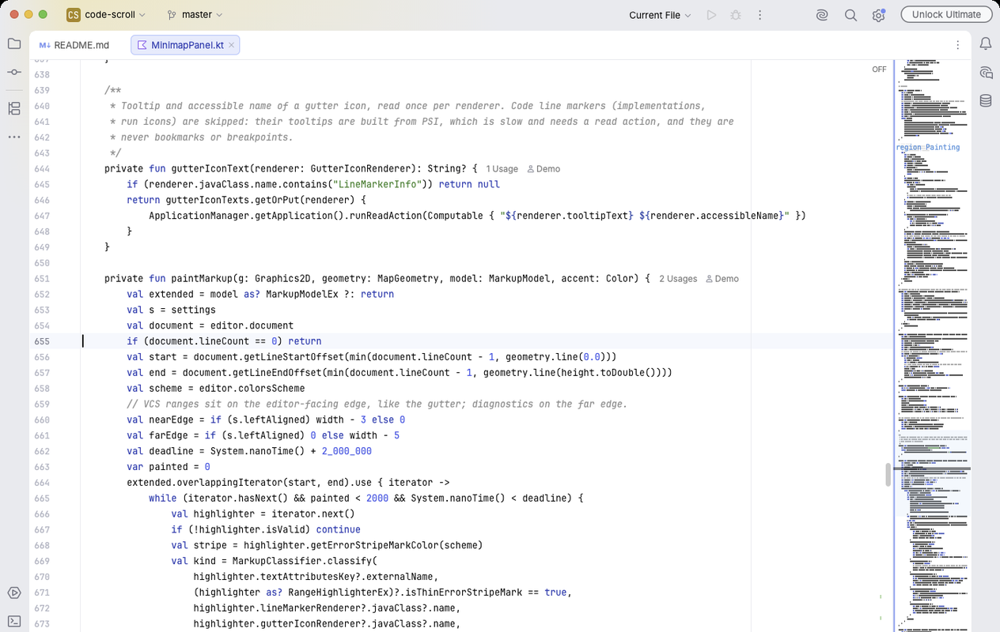

<div align="center">

<picture>
  <source media="(prefers-color-scheme: dark)" srcset="docs/logo-dark.svg">
  
</picture>

<h1>Code Scroll</h1>

<p><b>Oh, just another code minimap for JetBrains IDEs.</b></p>

<p>
  <a href="https://github.com/oh-just-another/code-scroll/actions/workflows/verify.yml"></a>
  
  <a href="LICENSE"></a>
</p>

<p>
  <a href="#installation">Installation</a> ·
  <a href="#using-the-minimap">Using the Minimap</a> ·
  <a href="#settings">Settings</a> ·
  <a href="#building">Building</a>
</p>

</div>

Code Scroll adds a minimap to the editors of JetBrains IDEs. It shows the whole file in syntax colors next to the
code, marks errors, changes and bookmarks on it, and lets you scroll by dragging the frame that shows where you are.
It works in IntelliJ IDEA, WebStorm, Rider, Android Studio and other IDEs from version 2026.2.

<picture>
  <source media="(prefers-color-scheme: dark)" srcset="docs/screenshot-dark.png">
  
</picture>

## Installation

Until the plugin is on JetBrains Marketplace, build it (see [Building](#building)) and open **Settings | Plugins**,
click the gear icon, choose **Install Plugin from Disk** and pick `build/distributions/code-scroll-<version>.zip`.

## Using the Minimap

Drag the frame to scroll the editor. When you press anywhere else on the map, the frame jumps there and keeps following
the mouse while you hold the button. Hold **Shift** while clicking to extend the selection to that line, and use the
mouse wheel over the map to scroll as in the editor.

Rest the pointer on the map to see the code under it in a popup. To change the map's width, drag its inner edge.

Right-click the map for the options you change most often: fit the whole file, show errors and warnings, keep the
caret in place, hide the map in this editor or in all editors. The **View** menu has three switches: **Toggle Code
Scroll Minimap** for all editors, **Code Scroll in This Editor** for the current one, and **Toggle Code Scroll
Diagnostics** for error and warning marks. None of them has a default shortcut, so assign one in **Settings | Keymap**
if you use them often.

In Markdown files the map labels headings, and the rendered preview gets its own map. Scrolling with that map also
scrolls the source, unless you turn it off. The preview's context menu has a **Code Scroll** submenu for its map.

## Settings

All settings are in **Settings | Editor | Code Scroll**. Every option has a short explanation under it, and the
settings search finds them by name.

| Setting | Default | What it does |
|---|---|---|
| **Appearance** | | |
| Enable minimap | on | Shows the minimap in editors. |
| Align left | off | Puts the map on the left side of the editor instead of the right. |
| Fit to editor height | off | Squeezes the whole file into the map's height. When off, each line keeps a fixed height and the map scrolls with the editor. |
| Fill editor height | off | With Fit, stretches a short file to the full height. |
| Syntax colors | on | Draws the code in the colors of the editor's color scheme. When off, the map is one color. |
| Dim comments | off | Draws comments fainter, so the code stands out. |
| Render style | `CLEAN` | `CLEAN` draws each word as a solid stroke. `ACCURATE` shapes letters, so capitals and descenders are visible. |
| Text intensity | 70 % | How strongly the text stands out from the background, from 20 to 100 %. |
| Pixels per line | 3 | Height of one line on the map when Fit is off, from 1 to 8. |
| Hide editor scrollbar | off | Hides the editor's own scrollbar while the map is shown. |
| **Width** | | |
| Automatic width | on | Narrows the map in narrow and split editors. |
| Lock width | off | Stops the map from being resized by dragging. |
| Main editors | 110 px | Map width in file editors, from 40 to 300 px. |
| Diff editors | 60 px | Map width in diff and merge views. |
| Preview editors | 70 px | Map width in preview editors. |
| Consoles | 60 px | Map width in console output. |
| Untyped editors | 60 px | Map width in editors without a file type. |
| Rendered Markdown | 96 px | Map width in the rendered Markdown preview. You can also drag the map's left edge. |
| **Colors** | | |
| Viewport | scheme | Fill of the frame that shows the visible part of the file. |
| Viewport opacity | 38 | Transparency of the frame fill, from 0 to 255. The frame gets brighter while you hover or drag it. |
| Viewport border | scheme | Color of the frame's border. |
| Border opacity | 110 | Transparency of the border, from 0 to 255. |
| Border width | 0 px | Thickness of the border. At 0 the frame has no border. |
| Caret line | scheme | Line that marks the caret. |
| Selection | scheme | Band that marks selected lines. |
| Marker labels | scheme | Color of TODO, region and other marker labels. |
| Declaration labels | scheme | Color of class and method labels. |
| **Navigation and Preview** | | |
| Click timing | `DOWN` | `DOWN` moves the frame when you press, `UP` when you release, `NONE` only lets you drag the frame. |
| Click by mouse position | off | Puts the caret at the clicked column, not only on the clicked line. |
| Scroll only | off | Scrolls the editor without moving the caret or the selection. |
| Show hover preview | on | Shows the code under the pointer in a popup. |
| Line numbers in preview | on | Shows line numbers in the popup. |
| Scroll preview with mouse wheel | off | While the popup is open, the wheel scrolls the popup instead of the editor. |
| Hover delay | 250 ms | How long the pointer rests before the popup appears, from 0 to 2000 ms. |
| Show only on hover | off | Keeps the map collapsed to a narrow strip until you point at it. |
| Show quick hide button | on | Adds a × button that hides the map in the current editor. |
| Rendered Markdown minimap | on | Adds a map to the rendered Markdown preview. |
| Sync source with Markdown minimap | on | Scrolls the Markdown source when you scroll with the preview's map. |
| **Editors** | | |
| Main editors | on | Shows the map in file editors. |
| Diff editors | on | Shows the map in diff and merge views. |
| Preview editors | on | Shows the map in preview editors. |
| Consoles | off | Shows the map in console output. |
| Keep console minimap empty | on | In consoles, draws only the frame, without text. |
| Untyped editors | off | Shows the map in editors without a file type. |
| Keep untyped minimap empty | on | In untyped editors, draws only the frame, without text. |
| Minimum lines | 0 | Hides the map in files shorter than this. At 0 there is no limit. |
| Maximum lines | 1,000,000 | Hides the map in files longer than this. |
| Keep an empty minimap outside the line limits | off | Instead of hiding the map, shows an empty one you can still drag. |
| Excluded extensions | `ipynb` | File extensions without a map, separated by commas. |
| Update delay | 120 ms | How long the map waits after you type before redrawing, from 50 to 2000 ms. |
| **Markers and Highlights** | | |
| Errors and warnings | on | Marks problems on the outer edge of the map. The two options below choose which ones. |
| Errors | on | Shows error marks. |
| Warnings | on | Shows warnings and other inspection results. |
| Full-line diagnostics | off | Draws error and warning marks across the whole width of the map. |
| VCS changes | on | Marks added, changed and deleted lines on the edge next to the code. |
| Bookmarks | on | Marks bookmarked lines. |
| Breakpoints | on | Marks lines with breakpoints on the edge next to the code. |
| Occurrences of the selection | on | Highlights every place in the file where the selected text appears. |
| Search results and usages | on | Highlights find results and highlighted usages. |
| Full-line other markup | off | Draws the remaining editor highlights across the whole width of the map. |
| Comment markers | on | Labels comments that contain a marker word or match the marker regex. |
| Marker words | `TODO,FIXME,MARK,region` | Words that turn a comment into a label. A word in capitals matches only in capitals. `region` and `MARK` count only at the start of a comment. |
| Marker regex | empty | Your own pattern for marker comments, up to 256 characters, without groups or alternation. |
| Declarations | on | Labels classes and types, and the methods chosen by the two filters below. |
| Method names | empty | Methods to label, separated by commas or new lines. `*` matches any text, `?` one character. When empty, no methods are labeled. |
| Method annotations | empty | Label only methods with these annotations. When empty, the annotation doesn't matter. |
| Label font size | 10 | Size of marker and declaration labels, from 6 to 36. |

### Colors in Light and Dark Themes

A color marked "scheme" in the table comes from the editor's color scheme, so it changes when you switch between a
light and a dark theme. You can give each scheme its own minimap colors in **Settings | Editor | Color Scheme | Code
Scroll**. If you tick **Custom** next to a color in the Code Scroll settings, that color is used in every scheme.

## Known Limits

- The map shows document lines, so folded code and soft-wrapped lines take as much room as unfolded ones.
- Class and method labels come from the text of the file, not from the language's code model, so an unusual layout
  can hide a label or add a wrong one.
- Labels are looked for only in the first megabyte of a file, and lines are drawn up to 512 characters.
- When another plugin already occupies the side of the editor where the map goes, Code Scroll leaves that editor
  alone.
- The map in the rendered Markdown preview uses an API that JetBrains marks as experimental, so a future IDE version
  may change it.

## Building

You need JDK 25. Build the plugin with:

```sh
./gradlew buildPlugin
```

The zip appears in `build/distributions/`. To build against an IDE you already have instead of downloading one, add
`-PlocalIdePath=<path to the IDE>/Contents`. To try the plugin in a separate copy of the IDE, run `./gradlew runIde`.

## License

Code Scroll is released under the [MIT License](LICENSE).
